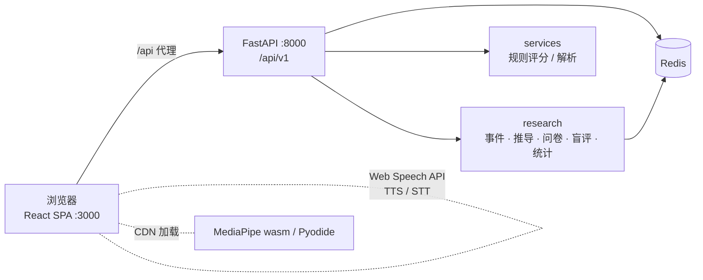

# 谈锋 Edgewise

谈锋 Edgewise 是一个 AI 模拟面试练习平台，同时是论文《AI 面试产品的创意营销研究——基于谈锋（Edgewise）的任务驱动机制分析》的数据采集载体。它用「承诺—体验—迁移」框架和 ZC×ZP 2×2 实验来记录用户的练习行为和问卷数据。评分全部基于规则，语音朗读和识别用的是浏览器自带的 Web Speech API，不需要接任何付费的大模型或语音接口。

## 功能

下面只列代码里已经能找到的功能。

**练习**
- 1v1 模拟面试：支持多轮面试，可以自定义轮数；问题分通用题和根据简历提取关键词生成的专属题；有追问、修改作答和逻辑性评分（`logic_scorer.py`）；还有反问环节和薪资谈判脚本
- 单向录制面试（`OneWayRoom`），作答录在本地
- 结构化面试（`StructuredLobby` / `StructuredRoom`）
- 群面 LGD：AI 角色参与讨论，按规则评分（`lgd_scorer.py`）
- 编程练习：Monaco 编辑器，JS 在 Web Worker 里运行，Python 通过 Pyodide 运行
- Case / 系统设计：带 Excalidraw 白板
- 在线测评：能力题和性格题（`aptitude_items.yaml`、`personality_items.yaml`）
- 一血通关挑战（`/challenge`）、定制工坊（`/studio`）

**准备与复盘**
- 简历上传解析（PDF / DOCX）、JD 解析与岗位匹配
- 题库（支持上传）、面经库（含审核队列）、STAR 故事库、准备任务页（静态生成）
- 复盘分析和单场报告，图表用 recharts；表达指标包括语速、停顿等；临场表现指标用 MediaPipe 人脸关键点在本地计算
- 面试日程，可以导出 ICS
- AI Copilot 分诊（基于规则）
- 分享卡片、结对练习（`/pair/:id`）、邀请与推荐
- 机构 / 导师视图（`/org/*`）

**研究模块**
- 知情同意、实验分组、行为事件采集、微问卷引擎、7 天后测、盲评、数据导出
- 管理员问卷统计页（`/management/research`）、项目框架页（`/management/framework`）

**规划中**
- 微问卷弹窗：后端的 `GET /research/survey/pending` 和作答接口已经做好，前端还没调用
- 外部语音识别：`src/api/stt.js` 目前只是占位，现在只走浏览器的 Web Speech API

## 技术栈

| 层 | 技术 |
| --- | --- |
| 前端 | React 19, Vite 8, React Router 7, Zustand 5, CSS Modules, axios, recharts, three / @react-three/fiber, Monaco, Excalidraw, @mediapipe/tasks-vision, vite-plugin-pwa |
| 后端 | FastAPI 0.115, Uvicorn, Pydantic Settings, PyJWT, bcrypt, redis-py 5（asyncio） |
| 文档解析 | pypdf, python-docx, PyYAML, jieba |
| 统计 | pandas, numpy, scipy（管理员统计用） |
| 存储 | Redis（唯一的数据存储） |

## 目录结构

```
.
├── index.html
├── package.json            # 前端脚本与依赖
├── vite.config.js          # 端口 3000，/api 代理到 127.0.0.1:8000，PWA
├── .env.example
├── content/tasks/          # 准备任务 Markdown 源文件
├── public/tasks/           # build-tasks 生成的静态页与 manifest
├── scripts/build-tasks.mjs # content/tasks → public/tasks + sitemap.xml
├── docs/                   # 补充说明
├── src/
│   ├── App.jsx             # 路由
│   ├── api/                # 按模块划分的 axios 封装
│   ├── components/         # Layout、Copilot、研究同意弹窗等
│   ├── config/             # experiment.js / tts.js / report.js
│   ├── features/           # 各页面（interview、lgd、coding、case、management …）
│   ├── hooks/              # useTTS、useSpeechToText、usePresence …
│   ├── research/track.js   # 前端研究事件上报
│   ├── stores/             # Zustand stores
│   └── utils/
└── backend/
    ├── run.py              # uvicorn app.main:app，0.0.0.0:8000，reload
    ├── requirements.txt
    ├── app/
    │   ├── main.py         # FastAPI 应用，启动时连接 Redis 并写入种子数据
    │   ├── config.py       # 环境变量
    │   ├── api/v1/         # 路由（统一挂在 /api/v1）
    │   ├── core/           # redis_client、security（JWT、密码哈希）
    │   ├── services/       # 业务逻辑与各评分器
    │   ├── research/       # 研究模块（事件、推导、问卷、盲评、admin_stats）
    │   ├── data/           # YAML 题库与种子数据
    │   └── models/schemas.py
    ├── scripts/generate_pdf_seed.py
    └── tests/              # pytest 用例
```

## 架构



## 快速开始

需要准备：Node.js（Vite 8 要求较新的版本，建议 20 及以上）、Python 3、一个本地 Redis（默认地址 `redis://localhost:6379/0`）。

```bash
# 1. Redis
redis-server            # 或用任意方式启动本地 Redis

# 2. 后端
cd backend
python -m venv .venv && source .venv/bin/activate
pip install -r requirements.txt
cp ../.env.example .env # 然后修改 JWT_SECRET 等
python run.py           # http://localhost:8000，接口文档在 /docs

# 3. 前端（另开一个终端，在仓库根目录）
npm install
npm run dev             # http://localhost:3000，会先运行 build-tasks
```

### 前端脚本

| 命令 | 作用 |
| --- | --- |
| `npm run dev` | 生成任务静态页，然后启动 Vite 开发服务器（端口 3000） |
| `npm run build` | 生成任务静态页，然后执行 `vite build` |
| `npm run preview` | 预览构建产物 |
| `npm run build:tasks` | 只生成 `public/tasks` 和 `sitemap.xml` |

### 环境变量

后端变量放在 `backend/.env`，由 `app/config.py` 读取。

| 变量 | 默认值 | 说明 |
| --- | --- | --- |
| `APP_ENV` | `development` | 设为 `production` 时，若仍使用占位 `JWT_SECRET` 会拒绝启动 |
| `REDIS_URL` | `redis://localhost:6379/0` | Redis 连接地址 |
| `JWT_SECRET` | 开发占位值 | **部署时必须改成强随机串**；生产环境不允许沿用占位值 |
| `JWT_ALGORITHM` | `HS256` | |
| `JWT_EXPIRE_MINUTES` | `1440` | |
| `CORS_ORIGINS` | `["http://localhost:3000","http://localhost:5173"]` | JSON 数组 |
| `RESEARCH_HASH_SECRET` | 空（为空时回退到 `JWT_SECRET`） | 研究导出里用户 ID 的 HMAC 密钥 |

前端和构建用的变量：

| 变量 | 默认值 | 说明 |
| --- | --- | --- |
| `VITE_API_BASE` | `/api/v1` | 接口前缀；开发时由 Vite 代理到 8000 端口 |
| `EDGEWISE_SITE_ORIGIN` | `https://edgewise.app` | build-tasks 生成 sitemap 时用的域名 |

### 初始数据与管理员

后端启动时会执行 `seed_all`，写入题库、群面房间和一个演示账号（见 `backend/app/services/seed_service.py`）。演示账号带管理员权限，并且默认已同意研究。普通注册用户**不会**自动成为管理员；如需提权，请在 Redis 里把对应用户的 `is_admin` 改为 `true`，或仅保留演示管理员账号。

## API 概览

所有接口都挂在 `/api/v1` 下，除公开页面外都需要 `Authorization: Bearer <JWT>`。完整的接口定义可以在后端启动后打开 `http://localhost:8000/docs` 查看。

| 分组 | 前缀 | 主要接口 |
| --- | --- | --- |
| 认证 | `/auth` | register / login / me / logout |
| 面试 | `/interview` | sessions、score-answer、attempts、followup、revision-decision、reverse-qa、negotiation/turn、complete、research-followup |
| 群面 | `/lgd` | topics、rooms、score |
| 编程 | `/coding` | sessions、attempts、explain、complete |
| Case | `/case` | prompts、sessions、clarify、step |
| 测评 | `/assessment` | sessions、answers、complete |
| 简历 / 岗位 | `/resume`、`/jobs` | upload、jobs CRUD、`/{job_id}/match` |
| 题库 / 面经 / 故事 | `/questions`、`/experiences`、`/stories` | 列表、上传、审核、CRUD |
| 概览 / 日程 | `/dashboard`、`/schedule` | overview、recent-sessions、schedule CRUD |
| 准备任务 / 创作者 | `/tasks`、`/series` | visit / stats、系列 |
| 分享 | `/share/cards`、`/pair` | 分享卡片、结对练习 |
| 机构 | `/org` | admin/orgs、join、mentor、aggregate |
| Copilot | `/copilot` | triage、micro-done |
| 研究 | `/research` | consent、experiment、events、survey/pending、survey/answer、posttest/*、invite、referral/*、derive/daily、blind-review/*、export、export/panel |
| 研究管理 | `/research/admin` | meta、overview、passive、survey/items、experiment、crosstab、reliability、users、timeline、blind-review/progress、coding、export（仅管理员） |

## 研究模块说明

代码在 `backend/app/research/`、`backend/app/services/research_service.py` 和 `src/research/`。

- **知情同意**：用户通过 `ResearchConsentModal` 和 `POST /research/consent` 同意或拒绝，当前版本号是 `2026-11-03-full`。撤回同意后会清空该用户的问卷队列（`clear_survey_on_withdraw`）。
- **实验分组**：只有同意了的用户才分组。组别是 `00 / 01 / 10 / 11` 四个之一，第一位代表 ZC（跨触点任务连续性），第二位代表 ZP（参与方式）。分配时选当前人数最少的组（`research:arm_count:*`），分好之后不再改变。各组强制开启哪些功能，见 `experiment_config.py` 和 `src/config/experiment.js` 里的 `FORCED_BY_ARM`。
- **被动数据（问卷 A）**：前端用 `trackResearchEvent` 上报事件到 `POST /research/events`，写入 Redis Stream `research:event:{user_id}`。`derive.py` 再把事件推导成指标，存进 `research:auto:{user_id}`，推导的元信息存在 `:meta`。当前规则版本是 `RULE_VERSION`（见 `keys.py`）。
- **主动数据（问卷 B）**：题目定义在 `survey_items.yaml`，按触发点（例如 `consent_granted`、`report_view_first`、`second_session_complete`、`channel_*`、`institution` 等）进入 `research:survey:{user_id}:queue`。每次最多弹 3 题，24 小时内最多弹 2 次，同一题连续跳过 2 次就不再出现。作答存在 `research:survey:{user_id}`。自评题一律不会自动填写。
- **后测与盲评**：分组 7 天后开放后测（`/research/posttest`），14 天后有追踪任务。后测的回答进入 `research:blind_review:pool`，由评分人盲评。
- **隐私**：管理员统计和导出里，用户只以 HMAC-SHA256 哈希的前 12 位出现（`admin_stats/privacy.py`）。人数少于 5 的格子显示 `<5`，文本会做脱敏。管理员的操作会记录审计日志（`audit.py`）。
- **管理员统计**：前端页面 `/management/research`（`src/features/management/research-stats/`）有概览、被动数据、问卷、实验对比、交叉分析、信度、单用户时间线和盲评进度这几个标签页。后端接口在 `/research/admin/*`，统计依赖 pandas、numpy、scipy。页面上的统计只作探索参考，论文里的正式分析请导出后另行完成。

## 浏览器要求

- 推荐用桌面版 Chrome 或 Edge。语音朗读（`speechSynthesis`）和语音识别（`SpeechRecognition`）依赖浏览器支持；不支持的浏览器会上报 `webspeech.unsupported` 事件。
- 微信内置浏览器的语音能力有限，页面会提示用系统浏览器打开（`WeChatSpeechTip`）。
- 摄像头和麦克风需要用户授权。MediaPipe 模型和 Pyodide 首次使用时会从 CDN（jsDelivr、storage.googleapis.com）加载，离线环境下这两项功能不能用。
- 支持 PWA，`/api/*` 请求一律走网络，不缓存。

## 开发说明

- 后端测试用 pytest：`cd backend && pip install pytest && pytest`（`requirements.txt` 里没有包含 pytest）。
- 前端部分模块用 Node 内置的测试运行器：`node --test src/features/interview/*.test.js`。
- Redis 里已有的 key 和接口只能新增、不要修改，研究数据依赖它们保持稳定。研究相关的 key 统一写在 `backend/app/research/keys.py`。
- 推导规则或题库改动后，要同步更新 `RULE_VERSION` / `SURVEY_ITEMS_VERSION`，这样统计时可以按版本筛选。
- 缺失值不能当成 0；跳过、拒答、未作答要分开记录。
- 新增准备任务：在 `content/tasks/` 里加一个 Markdown 文件，再运行 `npm run build:tasks`（见 `docs/task-pages-static.md`）。

## License

MIT License。详见仓库根目录 [LICENSE](./LICENSE)。
