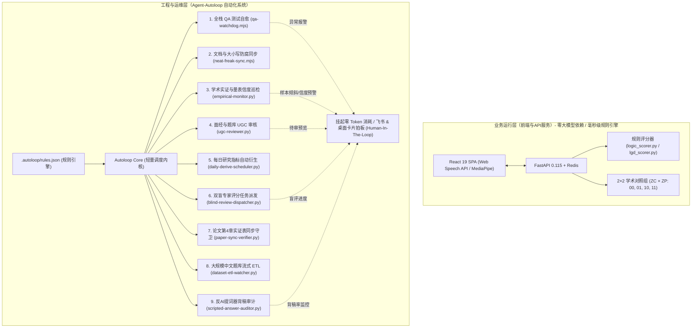

# Edgewise 与数字生命卡兹克 Agent-Autoloop 自动化体系集成指南

本指南系统阐述如何将 **数字生命卡兹克（KKKKhazix）** 开源的 **[Agent-Autoloop](https://github.com/KKKKhazix/agent-autoloop)** 自动化中台与 **[khazix-skills](https://github.com/KKKKhazix/khazix-skills)** 规范深度融合至 **谈锋（Edgewise）** 项目中。

---

## 一、 架构定位与设计哲学

在保持谈锋（Edgewise）核心产品定位与学术研究严密性的前提下，本体系采用**双层解耦设计**：



### 1. 业务运行层（严格保持零外部大模型依赖）
- **学术对照严密性**：Edgewise 作为《AI 面试产品的创意营销研究》实证论文的数据采集载体，必须保证 2×2（ZC×ZP）实验因子环境的绝对确定性与可复现性。评分逻辑完全基于规则与词频特征（`logic_scorer.py`、`lgd_scorer.py`）。
- **极速响应与零边际成本**：纯规则算法后端响应时间 < 50ms，且无任何商用大模型 API 调用费用。因此，**严禁将自主 Agent 侵入至终端用户的在线面试主流程中**。

### 2. 工程与运营层（全面拥抱 Agent-Autoloop 自动化）
- **后台自治循环**：工程测试、质量守卫、学术数据监控、面经题库审核均交给 Autoloop 调度。
- **挂起零消耗与人机协同（HITL）**：平时在后台静默运行，无需人工死盯终端；仅在遇到测试断言失败、样本量倾斜、敏感内容需要审核等关键决策点时，生成结构化卡片推送到飞书或桌面通知，等待人工一键拍板。

---

## 二、 九大核心自动化流水线

### 1. 全栈 QA 回归与自愈守卫 (`scripts/autoloop/qa-watchdog.mjs`)
- **功能**：自动运行全量 5 套前端单元测试、后端 Python `unittest` 测试套件（`test_research_suite.py`、`test_lgd_sandbox_memory.py`、`test_lgd_scorer.py`）及 172 个覆盖 Tiers 1–4 的 E2E 端到端测试。
- **自治机制**：
  - 测试通过时：输出绿色状态指示，系统进入挂起零消耗待机。
  - 测试失败时：自动采集堆栈与上下文，合成故障诊断 Payload，唤醒本地命令行 Agent（如 Claude Code 或 Codex）生成修复补丁，并向管理员推送带操作按钮（`Approve Patch` / `Retry` / `Discard`）的飞书审批卡片。

### 2. 架构与文档“防脑腐”同步器 (`scripts/autoloop/neat-freak-sync.mjs`)
- **理念**：贯彻卡兹克生态中的 `neat-freak` 洁癖规范，彻底消除开源项目在长期迭代中产生的“文档与代码不一致”的脑腐问题。
- **校验项**：
  - 严格执行大小写敏感路径核验（`existsCaseSensitive`），核验 [PROJECT.md](file:///Users/zzz/Downloads/Edgewise/PROJECT.md) 中的 21 个功能清单（F01–F21）及 API 客户端（含 `src/api/stt.js`）是否均有物理源码对应。
  - 核验 8 大 UI 原语（`Button`, `Card`, `Input`, `SegmentedControl`, `Switch`, `Badge`, `Modal`, `PageBar`）是否符合设计契约。
  - 核验 CSS Token Bridge 核心变量与向前兼容别名、SEO `tasks_manifest.json` 产物新鲜度以及核心路由注册完整性。

### 3. 学术实证数据与量表信度巡检 (`scripts/autoloop/empirical-monitor.py`)
- **功能**：面向论文数据收集的每日学术健康度与量表心理测量学审计。
- **指标**：
  - 自动读取 Redis 统计 4 组（00、01、10、11）被试样本量分布，计算卡方检验统计量（$\chi^2$）与失衡比率（Imbalance Ratio）。
  - 计算 `scale_v1` 五大核心量表构念（`cognitive_trust`、`affective_trust`、`adoption_intent`、`word_of_mouth`、`reuse_intent`）的克隆巴赫系数（Cronbach's $\alpha \ge 0.70$）。
  - 监控 `blind_pool` 双盲专家评分积压率，生成日报简报卡片。

### 4. 面经与题库 UGC 内容初审流水线 (`scripts/autoloop/ugc-reviewer.py`)
- **功能**：连接在线 Redis `experiences:pending` 待审队列（支持离线基线回退），对社区用户上传的面经与题目进行全自动治理。
- **治理项**：
  - 隐私脱敏：调用 `experience_sanitize` 自动检测并脱敏手机号、邮箱、身份证与微信等私人联系方式。
  - STAR 完整度评分：结构化评估情境（Situation）、任务（Task）、行动（Action）、结果（Result）要素完整率。

### 5. 每日研究指标自动衍生调度器 (`scripts/autoloop/daily-derive-scheduler.py`)
- **功能**：自动调用 `backend/app/services/research_derive_service.py`（及 `scripts/run_daily_derive.py`），将 `research:events` 埋点流与 `session:*` 聚合为每日被试面板特征（`research:derived:daily:YYYY-MM-DD`）。

### 6. 双盲专家评分任务派发与间信度守卫 (`scripts/autoloop/blind-review-dispatcher.py`)
- **功能**：扫描 `research:blind_pool` 与 `research:blind_reviews:*`，监控双盲评分员完成进度并检验跨评分员一致性（Inter-Rater Reliability）。

### 7. 论文第4章实证表格同步守卫 (`scripts/autoloop/paper-sync-verifier.py`)
- **功能**：核验 `docs/paper_empirical_analysis.md` 中表 4-1 至表 4-9 及命题 P1–P6 与 `scripts/run_empirical_analysis.py` 统计引擎 100% 确定性对齐。

### 8. 大规模中文面试题库流式 ETL 守卫 (`scripts/autoloop/dataset-etl-watcher.py`)
- **功能**：监控 `面试数据集/Chinese_interview_large.json`（95万行）与 `backend/app/data/dataset_import_seed.py`、`backend/app/data/pdf_import_seed.py` 的同步状态。

### 9. 反 AI 提词器与背稿真实度审计器 (`scripts/autoloop/scripted-answer-auditor.py`)
- **功能**：扫描个人模拟面试与 LGD 群面发言记录，对标市面上“提词器外挂”高频套话与零承接背稿行为，输出真实度审计卡片。

---

## 三、 快速上手与 CLI 命令

本地支持直接通过 `npm` 运行全部自动化能力，或配合全局 `agent-autoloop` 使用：

### 1. 本地独立运行
```bash
# 1. 验证 Autoloop 9 大规则与脚本依赖
npm run autoloop:check

# 2. 运行完整 9 大自动化管线
npm run autoloop

# 3. 单独运行特定管线
npm run autoloop:sync          # 架构与文档防腐校验
npm run autoloop:qa            # 全栈单元测试 + E2E QA 测试守护
npm run autoloop:empirical     # 学术实验数据与量表信度巡检
npm run autoloop:ugc           # UGC 面经内容初审
npm run autoloop:derive        # 每日研究聚合指标自动衍生
npm run autoloop:blind         # 双盲专家评分任务派发巡检
npm run autoloop:paper         # 论文第4章实证表 4-1~4-9 同步守卫
npm run autoloop:dataset       # 95万行中文面试数据集与PDF种子守卫
npm run autoloop:anti-script   # 反AI提词器与背稿真实度审计
```

### 2. 配合全局 `agent-autoloop` 守护进程使用
如果你已经在电脑上安装了数字生命卡兹克的 `agent-autoloop`：
```bash
# 查看 agent-autoloop 状态
agent-autoloop status

# 检查 Edgewise 项目内的规则配置
agent-autoloop check .autoloop/rules.json

# 将 Edgewise 规则挂入全局调度
cp .autoloop/rules.json ~/.agent-autoloop/rules.json
```

---

## 四、 持续集成（CI/CD）

本项目内置了 [`.github/workflows/autoloop-ci.yml`](file:///Users/zzz/Downloads/Edgewise/.github/workflows/autoloop-ci.yml)，在每次代码推送到 `main` 分支或发起 PR 时，GitHub Actions 会自动执行：
1. `npm run autoloop:sync`：确保文档无脑腐、契约 100% 达成。
2. `npm run autoloop:check`：核查自动化配置健康度。
3. `npm test`：执行 26 个单元测试 + 172 个 E2E 端到端测试。
4. `npm run autoloop:empirical -- --json`：验证学术数据流水线可执行性。
