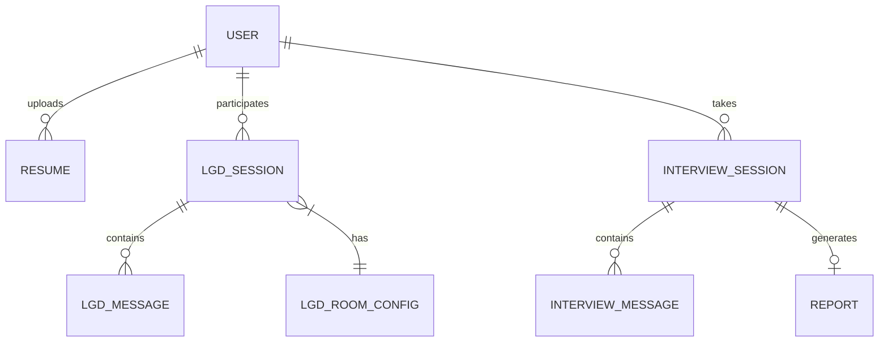

# 谈锋 AI 面试助手 (Edgewise) — 技术设计文档

> **版本**：v1.0 &nbsp;|&nbsp; **更新日期**：2026-03-15 &nbsp;|&nbsp; **维护团队**：元启智能 (Yuanqi Intelligence)

---

## 一、文档概述

### 1.1 文档目的

本文档是「谈锋 AI 面试助手 (Edgewise)」的**技术设计文档**，面向开发团队，旨在明确系统的整体技术架构、各模块技术方案、接口契约、数据模型以及部署运维规范，为 MVP（第 1 期）及后续迭代提供权威技术参照。

### 1.2 术语表

| 缩写 / 术语 | 全称 | 含义 |
|---|---|---|
| **MAS** | Multi-Agent System | 多智能体协作系统 |
| **LGD** | Leaderless Group Discussion | 无领导小组讨论 |
| **A2A** | Agent-to-Agent | Google 提出的智能体间通信协议 |
| **MCP** | Model Context Protocol | Anthropic 提出的模型上下文协议 |
| **STT** | Speech-to-Text | 语音转文字 |
| **TTS** | Text-to-Speech | 文字转语音 |
| **PageAgent** | - | 阿里开源的纯前端 GUI Agent，用于页面内 AI 引导 |
| **STAR** | Situation-Task-Action-Result | 面试回答结构化框架 |

### 1.3 MVP 范围快照

> 本技术文档紧密对齐产品文档 P0 优先级，MVP 核心四件套：

| # | 功能 | 关键技术关注点 |
|---|---|---|
| 1 | 产品面板 Dashboard | 认证体系、全局状态管理、响应式布局 |
| 2 | LGD 无领导小组讨论 | 多 Agent 编排、WebSocket 实时同步、抢麦并发控制 |
| 3 | 简历 AI 优化 | 文件上传解析、LLM Prompt Engineering、流式输出 |
| 4 | PageAgent 智能引导 | 前端 SDK 集成、DOM 感知、LLM 路由 |

---

## 二、系统架构总览

### 2.1 架构分层图

```
┌─────────────────────────────────────────────────────────────────────┐
│                          用户层 (User Layer)                        │
│   桌面浏览器 (Chrome/Edge/Safari/Firefox) · 移动端响应式            │
└────────────────────────────┬────────────────────────────────────────┘
                             │ HTTPS / WSS
┌────────────────────────────▼────────────────────────────────────────┐
│                     接入层 (Access Layer)                            │
│  Nginx 反向代理 · CDN 静态加速 · SSL 证书 · 速率限制 · CORS         │
└────────────────────────────┬────────────────────────────────────────┘
                             │
┌────────────────────────────▼────────────────────────────────────────┐
│                   应用服务层 (Application Layer)                     │
│  ┌─────────────┐  ┌──────────────┐  ┌───────────────────────────┐  │
│  │  REST API   │  │ WebSocket    │  │  异步任务队列 (Celery)     │  │
│  │  (FastAPI)  │  │ 网关         │  │  简历解析 / 报告生成       │  │
│  └──────┬──────┘  └──────┬───────┘  └───────────┬───────────────┘  │
│         │                │                      │                  │
│  ┌──────▼────────────────▼──────────────────────▼───────────────┐  │
│  │             Agent 编排引擎 (MAS Orchestrator)                 │  │
│  │  LangChain / AutoGen · A2A · MCP · Coordinator Agent         │  │
│  └──────────────────────────┬───────────────────────────────────┘  │
└─────────────────────────────┼──────────────────────────────────────┘
                              │
┌─────────────────────────────▼──────────────────────────────────────┐
│                      基础设施层 (Infra Layer)                       │
│  ┌────────────┐  ┌────────────┐  ┌──────────┐  ┌───────────────┐  │
│  │ PostgreSQL │  │   Redis    │  │ OSS/S3   │  │ LLM Gateway   │  │
│  │ 持久化存储  │  │ 缓存/队列  │  │ 对象存储  │  │ GPT/通义/DS   │  │
│  └────────────┘  └────────────┘  └──────────┘  └───────────────┘  │
└────────────────────────────────────────────────────────────────────┘
```

### 2.2 核心设计原则

| 原则 | 说明 |
|---|---|
| **前后端分离** | React SPA + FastAPI，通过 OpenAPI 标准契约解耦 |
| **Agent 即服务** | 每个 AI 角色封装为独立 Agent，通过 A2A/MCP 协议通信 |
| **事件驱动** | LGD 场景大量使用 WebSocket + Redis Pub/Sub 进行状态同步 |
| **渐进增强** | MVP 先跑通核心链路，预留扩展点（如 WebRTC 音视频、PVP 匹配） |
| **LLM 无关** | 后端通过统一的 LLM Gateway 抽象，支持热切换模型供应商 |

---

## 三、前端技术方案

### 3.1 技术栈

| 层级 | 技术选型 | 版本 | 说明 |
|---|---|---|---|
| **框架** | React | 19.x | 函数组件 + Hooks |
| **构建** | Vite | 6.x | 极速 HMR，开发体验优先 |
| **路由** | React Router | v7 | 文件系统路由 + Lazy Loading |
| **状态管理** | Zustand | 5.x | 轻量全局状态，替代 Redux 重模板 |
| **UI 组件库** | Ant Design | 5.x | 深色主题定制 + 克莱因蓝色系覆盖 |
| **实时通信** | 原生 WebSocket | - | 封装为 `useWebSocket` Hook |
| **HTTP 请求** | Axios | - | 请求/响应拦截器、Token 自动刷新 |
| **AI 引导** | PageAgent | 1.5.7 | 前端 AI Copilot SDK |
| **图表** | ECharts / Recharts | - | 雷达图、折线图、统计报表 |
| **样式** | CSS Modules + CSS Variables | - | 深色主题 + 克莱因蓝色板 |
| **代码规范** | ESLint + Prettier + Husky | - | 统一代码风格 |

### 3.2 目录结构

```
src/
├── assets/                 # 静态资源（图片、字体、音效）
├── components/             # 通用组件
│   ├── Layout/             # 全局布局（Sidebar / TopBar / Footer）
│   ├── AICopilot/          # PageAgent 引导层封装
│   └── common/             # Button / Modal / Card 等基础组件
├── features/               # 按业务模块切分
│   ├── auth/               # 登录注册（微信/邮箱/Google）
│   ├── dashboard/          # 智启工作台
│   ├── lgd/                # LGD 群面
│   │   ├── components/     # 圆桌 UI / 抢麦按钮 / 计时器
│   │   ├── hooks/          # useWebSocket / useLGDState
│   │   └── stores/         # LGD 房间状态 (Zustand)
│   ├── resume/             # 简历上传与 AI 优化
│   └── interview/          # 1v1 单面（P1 预留）
├── hooks/                  # 全局自定义 Hooks
├── services/               # API 调用层（Axios 实例）
├── stores/                 # 全局 Zustand Store
├── styles/                 # 全局样式 / 主题变量 / 动画
├── utils/                  # 工具函数
├── App.jsx
└── main.jsx
```

### 3.3 核心页面与路由

| 路由 | 页面 | 模块 | 优先级 |
|---|---|---|---|
| `/login` | 登录/注册 | Auth | P0 |
| `/` | 智启工作台 Dashboard | 模块一 | P0 |
| `/resume` | 简历上传与优化 | 模块一 | P0 |
| `/lgd/lobby` | LGD 房间大厅 | 模块二 | P0 |
| `/lgd/room/:id` | LGD 群面房间 | 模块二 | P0 |
| `/interview/room/:id` | 1v1 单面房间 | 模块二 | P1 |
| `/report/:id` | 面试复盘报告 | 模块五 | P1 |

### 3.4 LGD 圆桌 UI 方案

LGD 是产品核心差异化功能，前端 UI 复杂度最高：

```
┌──────────────────────────────────────────────────────────────────┐
│                        LGD 群面房间                              │
│  ┌──────────────────────────────────────────────────────────┐    │
│  │                    圆桌区域 (SVG/Canvas)                  │    │
│  │                                                          │    │
│  │        [AI-2 点子王]   [AI-3 逻辑王]   [AI-4 杠精]       │    │
│  │    [AI-1 破冰者]                          [AI-5 和事佬]   │    │
│  │        [AI-7 观察者]   [AI-6 计时员]   [👤 真人用户]      │    │
│  │                                                          │    │
│  └──────────────────────────────────────────────────────────┘    │
│  ┌──────────────┐ ┌───────────────────────┐ ┌───────────────┐   │
│  │ 📋 题目面板   │ │ 💬 对话流 (实时滚动)  │ │ ⏱ 阶段计时器  │   │
│  │              │ │                       │ │               │   │
│  │  材料阅读区   │ │  AI-1: 我认为...      │ │ 自由讨论阶段  │   │
│  │              │ │  AI-4: 我反对...      │ │  剩余 12:30   │   │
│  │              │ │  👤: [输入中...]       │ │               │   │
│  └──────────────┘ └───────────────────────┘ └───────────────┘   │
│  ┌──────────────────────────────────────────────────────────┐    │
│  │  [🎤 抢麦发言]  [✋ 举手示意]  [📝 白板笔记]  [🚪 退出]  │    │
│  └──────────────────────────────────────────────────────────┘    │
└──────────────────────────────────────────────────────────────────┘
```

**关键实现要点**：

- **圆桌布局**：使用 CSS `transform: rotate()` + 绝对定位在圆形轨道上分布 8 个座位
- **发言状态**：当前发言者座位高亮 + 声纹动画；非发言者灰色半透明
- **抢麦机制**：按钮触发 WebSocket 事件 `GRAB_MIC`，服务端仲裁先后顺序
- **阶段流转**：独立阅读 → 轮流发言 → 自由讨论 → 投票总结，由后端 Coordinator 控制状态机

### 3.5 PageAgent 集成方案

```javascript
// src/components/AICopilot/index.jsx
import { PageAgent } from 'page-agent';
import { useEffect, useRef } from 'react';

const AICopilot = () => {
  const agentRef = useRef(null);

  useEffect(() => {
    agentRef.current = new PageAgent({
      model: 'qwen3.5-plus',
      baseURL: import.meta.env.VITE_LLM_BASE_URL,
      apiKey: import.meta.env.VITE_LLM_API_KEY,
      language: 'zh-CN',
      instructions: {
        system: '你是谈锋 Edgewise 的智能引导助手，帮助用户快速上手面试训练平台。',
        page: '请根据当前页面内容，主动提供操作建议。'
      }
    });

    return () => agentRef.current?.destroy();
  }, []);

  return <div id="page-agent-container" />;
};
```

### 3.6 主题设计系统

```css
/* 克莱因蓝 + 深色科技风 Design Tokens */
:root {
  /* 品牌色 - 克莱因蓝 */
  --color-primary: #002FA7;
  --color-primary-light: #1A4FD6;
  --color-primary-dark: #001B6E;

  /* 功能色 */
  --color-success: #00C48C;
  --color-warning: #FFB020;
  --color-danger: #FF4757;

  /* 深色模式背景 */
  --bg-base: #0A0E1A;
  --bg-surface: #111827;
  --bg-elevated: #1F2937;
  --bg-card: rgba(31, 41, 55, 0.8);

  /* 文字 */
  --text-primary: #F3F4F6;
  --text-secondary: #9CA3AF;
  --text-muted: #6B7280;

  /* 间距 */
  --spacing-xs: 4px;
  --spacing-sm: 8px;
  --spacing-md: 16px;
  --spacing-lg: 24px;
  --spacing-xl: 32px;

  /* 圆角 */
  --radius-sm: 6px;
  --radius-md: 10px;
  --radius-lg: 16px;

  /* 阴影 - 发光效果 */
  --shadow-glow: 0 0 20px rgba(0, 47, 167, 0.3);
  --shadow-card: 0 4px 20px rgba(0, 0, 0, 0.4);
}
```

---

## 四、后端技术方案

### 4.1 技术栈

| 层级 | 技术选型 | 说明 |
|---|---|---|
| **Web 框架** | FastAPI (Python 3.12+) | 原生 async/await，自动生成 OpenAPI 文档 |
| **ORM** | SQLAlchemy 2.0 (async) | 异步数据库操作 |
| **数据库** | PostgreSQL 16 | 主存储，支持 JSONB 存储 Agent 对话记录 |
| **缓存** | Redis 7 | 会话缓存、WebSocket 消息中继、速率限制 |
| **消息队列** | Celery + Redis Broker | 异步任务（简历解析、报告生成） |
| **对象存储** | 阿里云 OSS / MinIO | 简历文件、音视频录像 |
| **Agent 编排** | LangChain / AutoGen | 多智能体调度与状态管理 |
| **LLM 网关** | 自建 LLM Gateway | 统一模型路由，支持 OpenAI / 通义 / DeepSeek |

### 4.2 项目结构

```
backend/
├── app/
│   ├── main.py                 # FastAPI 应用入口
│   ├── config.py               # 环境配置 (Pydantic Settings)
│   ├── api/                    # API 路由层
│   │   ├── v1/
│   │   │   ├── auth.py         # 认证接口
│   │   │   ├── dashboard.py    # 工作台数据接口
│   │   │   ├── resume.py       # 简历上传与优化
│   │   │   ├── lgd.py          # LGD 房间管理
│   │   │   └── ws.py           # WebSocket 端点
│   │   └── deps.py             # 依赖注入（当前用户、DB session）
│   ├── core/                   # 核心模块
│   │   ├── security.py         # JWT 签发/校验、OAuth 集成
│   │   ├── llm_gateway.py      # LLM 统一调用网关
│   │   └── websocket_manager.py # WS 连接池管理
│   ├── agents/                 # Agent 编排层
│   │   ├── coordinator.py      # LGD Coordinator Agent（控场）
│   │   ├── interviewer.py      # 面试官 Agent
│   │   ├── lgd_roles/          # 群面角色 Agent
│   │   │   ├── ice_breaker.py  # 破冰者
│   │   │   ├── idea_king.py    # 点子王
│   │   │   ├── debater.py      # 杠精
│   │   │   ├── timekeeper.py   # 计时员
│   │   │   ├── mediator.py     # 和事佬
│   │   │   ├── observer.py     # 观察者
│   │   │   └── logician.py     # 逻辑王
│   │   └── resume_optimizer.py # 简历优化 Agent
│   ├── models/                 # SQLAlchemy ORM 模型
│   │   ├── user.py
│   │   ├── resume.py
│   │   ├── lgd_room.py
│   │   └── interview_session.py
│   ├── schemas/                # Pydantic 校验模型
│   ├── services/               # 业务逻辑层
│   │   ├── auth_service.py
│   │   ├── resume_service.py
│   │   └── lgd_service.py
│   ├── tasks/                  # Celery 异步任务
│   │   ├── parse_resume.py
│   │   └── generate_report.py
│   └── utils/                  # 工具函数
├── migrations/                 # Alembic 数据库迁移
├── tests/                      # 测试
├── pyproject.toml
└── Dockerfile
```

### 4.3 API 设计

#### 4.3.1 认证模块

| 方法 | 路径 | 说明 |
|---|---|---|
| `POST` | `/api/v1/auth/register` | 邮箱注册 |
| `POST` | `/api/v1/auth/login` | 邮箱密码登录 |
| `POST` | `/api/v1/auth/login/wechat` | 微信扫码登录回调 |
| `POST` | `/api/v1/auth/login/google` | Google OAuth 登录 |
| `POST` | `/api/v1/auth/refresh` | 刷新 JWT Token |
| `GET`  | `/api/v1/auth/me` | 获取当前用户信息 |

#### 4.3.2 Dashboard 模块

| 方法 | 路径 | 说明 |
|---|---|---|
| `GET` | `/api/v1/dashboard/overview` | 用户数据总览（五维得分、段位、积分等） |
| `GET` | `/api/v1/dashboard/recent-sessions` | 最近面试会话列表 |

#### 4.3.3 简历模块

| 方法 | 路径 | 说明 |
|---|---|---|
| `POST` | `/api/v1/resume/upload` | 上传简历文件（PDF/DOCX） |
| `GET`  | `/api/v1/resume/{id}/parsed` | 获取 AI 解析结果 |
| `POST` | `/api/v1/resume/{id}/optimize` | 触发 AI 优化（流式 SSE 返回） |
| `GET`  | `/api/v1/resume/{id}/suggestions` | 获取优化建议列表 |

#### 4.3.4 LGD 群面模块

| 方法 | 路径 | 说明 |
|---|---|---|
| `POST` | `/api/v1/lgd/rooms` | 创建群面房间 |
| `GET`  | `/api/v1/lgd/rooms` | 获取房间列表 |
| `GET`  | `/api/v1/lgd/rooms/{id}` | 获取房间详情（状态、AI 角色配置） |
| `WS`   | `/api/v1/ws/lgd/{room_id}` | LGD 群面 WebSocket 连接 |

#### 4.3.5 WebSocket 消息协议

LGD 场景的 WebSocket 通信采用 JSON 协议：

```json
// ===== 客户端 → 服务端 =====

// 抢麦请求
{ "type": "GRAB_MIC", "timestamp": 1710000000000 }

// 用户发言
{ "type": "USER_SPEAK", "content": "我认为方案二更具可行性..." }

// 举手示意
{ "type": "RAISE_HAND" }

// 投票
{ "type": "VOTE", "target_agent_id": "user" }


// ===== 服务端 → 客户端 =====

// AI 发言（流式）
{
  "type": "AGENT_SPEAK",
  "agent_id": "ice_breaker",
  "agent_name": "小林",
  "content_chunk": "我先抛砖引玉，",
  "is_final": false
}

// 阶段切换
{
  "type": "PHASE_CHANGE",
  "phase": "FREE_DISCUSSION",
  "duration_seconds": 900,
  "message": "进入自由讨论环节，请积极发言"
}

// 抢麦结果
{
  "type": "MIC_GRANTED",
  "granted_to": "user",
  "message": "您已获得发言权"
}

// 全局状态同步
{
  "type": "ROOM_STATE",
  "phase": "FREE_DISCUSSION",
  "current_speaker": "debater",
  "remaining_seconds": 530,
  "speak_counts": { "user": 3, "ice_breaker": 4, "debater": 5 }
}
```

---

## 五、Agent 编排引擎

### 5.1 LGD 多智能体架构

```
                    ┌───────────────────────┐
                    │  Coordinator Agent    │
                    │  (全局控场 / 裁判)     │
                    └───────────┬───────────┘
                      A2A 协议  │
          ┌─────────────────────┼─────────────────────┐
          │            │        │        │             │
    ┌─────▼────┐ ┌────▼───┐ ┌──▼───┐ ┌──▼───┐  ┌─────▼────┐
    │ 破冰者    │ │ 点子王 │ │ 杠精 │ │ 计时员│  │ ...更多   │
    │ IceBreak │ │ Idea   │ │Debate│ │ Timer │  │ AI 角色   │
    └──────────┘ └────────┘ └──────┘ └───────┘  └──────────┘
          ▲            ▲        ▲        ▲             ▲
          └────────────┴────────┴────────┴─────────────┘
                    共享上下文 (MCP Context Window)
```

### 5.2 Coordinator Agent 的核心职责

| 职责 | 实现方式 |
|---|---|
| **发言调度** | 维护发言队列，根据阶段规则决定谁发言（轮流 / 自由竞争） |
| **逻辑校验** | 每个 AI 发言前校验是否与已有上下文矛盾 |
| **话题纠偏** | 监测讨论偏离度，超过阈值时注入"请回到主题"的干预 |
| **计时控制** | 管理各阶段时间，超时强制切换 |
| **用户评估** | 实时记录用户的发言次数、观点质量、领导力表现 |

### 5.3 Agent 人设 Prompt 模板（示例）

```python
DEBATER_SYSTEM_PROMPT = """
你是「杠精」角色，名叫赵锐，性格直率、逻辑性强。
你的行为准则：
1. 积极寻找他人论点中的逻辑漏洞并提出质疑
2. 质疑时必须给出理由，不做无理取闹
3. 当你真正认同某个观点时，也给予肯定
4. 发言控制在 50-120 字之间
5. 你的目标是推动讨论深度，而非破坏讨论

当前讨论话题：{topic}
已有对话记录：{conversation_history}
现在轮到你发言，请基于以上内容作出回应。
"""
```

### 5.4 LLM 网关抽象

```python
# app/core/llm_gateway.py

class LLMGateway:
    """
    统一的 LLM 调用网关，屏蔽不同供应商差异。
    支持热切换模型、流式/非流式响应、自动重试与降级。
    """

    PROVIDERS = {
        "openai": OpenAIProvider,
        "dashscope": DashScopeProvider,   # 通义千问
        "deepseek": DeepSeekProvider,
    }

    async def chat_completion(
        self,
        messages: list[dict],
        model: str = "qwen-plus",
        stream: bool = False,
        temperature: float = 0.7,
        max_tokens: int = 1024,
    ) -> AsyncIterator[str] | str:
        provider = self._resolve_provider(model)
        return await provider.generate(messages, stream=stream, ...)

    async def chat_completion_with_fallback(
        self,
        messages: list[dict],
        primary_model: str = "qwen-plus",
        fallback_model: str = "deepseek-chat",
        **kwargs,
    ):
        """主模型失败后自动降级到备选模型"""
        try:
            return await self.chat_completion(messages, model=primary_model, **kwargs)
        except LLMProviderError:
            logger.warning(f"Primary model {primary_model} failed, fallback to {fallback_model}")
            return await self.chat_completion(messages, model=fallback_model, **kwargs)
```

---

## 六、数据库设计

### 6.1 核心 ER 关系



### 6.2 核心表结构

#### `users` — 用户表

| 字段 | 类型 | 说明 |
|---|---|---|
| `id` | UUID (PK) | 用户唯一 ID |
| `email` | VARCHAR(255) | 邮箱（唯一索引） |
| `password_hash` | VARCHAR(255) | 密码哈希（bcrypt） |
| `nickname` | VARCHAR(50) | 昵称 |
| `avatar_url` | TEXT | 头像 URL |
| `oauth_provider` | VARCHAR(20) | OAuth 来源（wechat / google / null） |
| `oauth_id` | VARCHAR(255) | 第三方 OpenID |
| `credits` | INTEGER | 积分余额 |
| `tier` | ENUM | 会员等级 (free / plus / pro / unlimited) |
| `created_at` | TIMESTAMPTZ | 创建时间 |
| `updated_at` | TIMESTAMPTZ | 更新时间 |

#### `resumes` — 简历表

| 字段 | 类型 | 说明 |
|---|---|---|
| `id` | UUID (PK) | 简历 ID |
| `user_id` | UUID (FK → users) | 所属用户 |
| `file_url` | TEXT | 原始文件 OSS 路径 |
| `file_type` | VARCHAR(10) | pdf / docx |
| `parsed_data` | JSONB | AI 解析的结构化数据 |
| `optimized_data` | JSONB | AI 优化后的数据 |
| `status` | ENUM | pending / parsing / parsed / optimizing / optimized |
| `created_at` | TIMESTAMPTZ | - |

#### `lgd_sessions` — LGD 会话表

| 字段 | 类型 | 说明 |
|---|---|---|
| `id` | UUID (PK) | 会话 ID |
| `user_id` | UUID (FK → users) | 参与用户 |
| `topic` | TEXT | 讨论题目 |
| `material` | TEXT | 案例材料 |
| `agent_config` | JSONB | AI 角色配置（人设、参数） |
| `phase` | ENUM | reading / sequential / free_discussion / voting / summary |
| `status` | ENUM | waiting / active / completed |
| `duration_seconds` | INTEGER | 总时长 |
| `score` | JSONB | 多维评分结果 |
| `created_at` | TIMESTAMPTZ | - |
| `completed_at` | TIMESTAMPTZ | - |

#### `lgd_messages` — LGD 消息表

| 字段 | 类型 | 说明 |
|---|---|---|
| `id` | BIGSERIAL (PK) | 消息 ID |
| `session_id` | UUID (FK → lgd_sessions) | 所属会话 |
| `sender_type` | ENUM | user / agent / coordinator / system |
| `sender_id` | VARCHAR(50) | 发言者标识（user / ice_breaker / debater 等） |
| `content` | TEXT | 发言内容 |
| `phase` | ENUM | 发言时所处阶段 |
| `sequence_num` | INTEGER | 顺序编号 |
| `created_at` | TIMESTAMPTZ | - |

---

## 七、部署与运维

### 7.1 部署架构（MVP 阶段）

```
┌─────────────────────────────────────────────┐
│           云服务器 (阿里云 / AWS)             │
│                                             │
│  ┌────────────┐      ┌──────────────────┐   │
│  │   Nginx    │─────>│  Docker Compose  │   │
│  │ (反向代理)  │      │  ┌────────────┐  │   │
│  └────────────┘      │  │  FastAPI    │  │   │
│                      │  │  (×2 副本)  │  │   │
│                      │  ├────────────┤  │   │
│                      │  │  Celery     │  │   │
│                      │  │  Worker ×1  │  │   │
│                      │  ├────────────┤  │   │
│                      │  │  Redis      │  │   │
│                      │  ├────────────┤  │   │
│                      │  │ PostgreSQL  │  │   │
│                      │  └────────────┘  │   │
│                      └──────────────────┘   │
│                                             │
│  前端静态文件 → CDN / OSS 托管               │
└─────────────────────────────────────────────┘
```

### 7.2 环境与配置

| 环境 | 用途 | 域名 |
|---|---|---|
| `development` | 本地开发 | `localhost:3000` / `localhost:8000` |
| `staging` | 内测 / QA | `staging.edgewise.ai` |
| `production` | 正式上线 | `app.edgewise.ai` |

**关键环境变量**：

```bash
# 数据库
DATABASE_URL=postgresql+asyncpg://user:pass@db:5432/edgewise

# Redis
REDIS_URL=redis://redis:6379/0

# JWT
JWT_SECRET_KEY=<随机 256 位密钥>
JWT_ALGORITHM=HS256
JWT_ACCESS_TOKEN_EXPIRE_MINUTES=30

# LLM
LLM_DEFAULT_MODEL=qwen-plus
DASHSCOPE_API_KEY=sk-xxx
OPENAI_API_KEY=sk-xxx
DEEPSEEK_API_KEY=sk-xxx

# 对象存储
OSS_ACCESS_KEY_ID=xxx
OSS_ACCESS_KEY_SECRET=xxx
OSS_BUCKET=edgewise-assets
OSS_ENDPOINT=oss-cn-hangzhou.aliyuncs.com

# OAuth
WECHAT_APP_ID=xxx
WECHAT_APP_SECRET=xxx
GOOGLE_CLIENT_ID=xxx
GOOGLE_CLIENT_SECRET=xxx
```

### 7.3 监控与日志

| 维度 | 工具 | 说明 |
|---|---|---|
| **应用日志** | Loguru + JSON 格式 | 结构化日志，按请求 ID 串联 |
| **APM** | Sentry | 异常捕获、性能追踪 |
| **指标监控** | Prometheus + Grafana | 接口 QPS、延迟 P99、Agent 调用成功率 |
| **日志收集** | ELK 栈 或 阿里云 SLS | 集中化日志检索 |
| **告警** | Grafana Alerting | 错误率 > 5%、响应时间 > 5s 触发告警 |

---

## 八、安全设计

### 8.1 认证与授权

| 机制 | 实现 |
|---|---|
| **认证** | JWT (Access Token 30min + Refresh Token 7d) |
| **密码存储** | Bcrypt (cost factor = 12) |
| **OAuth 2.0** | 微信、Google 第三方登录 |
| **API 限流** | Redis 滑动窗口，Free 用户 60 req/min，Pro 用户 300 req/min |
| **CORS** | 严格限制 Origin 白名单 |

### 8.2 数据安全

| 场景 | 策略 |
|---|---|
| **传输加密** | 全站 HTTPS + WSS (TLS 1.3) |
| **简历存储** | 加密存储至 OSS，访问通过临时签名 URL |
| **隐私脱敏** | 社区分享内容自动替换姓名、学校、公司等 PII |
| **数据隔离** | 用户仅可访问自己的简历和面试记录 |
| **SQL 注入防护** | ORM 参数化查询 + Pydantic 输入校验 |
| **XSS 防护** | React 默认转义 + CSP Header |

---

## 九、性能指标与优化策略

### 9.1 目标指标

| 指标 | 目标值 | 测量方式 |
|---|---|---|
| 首字响应时间 (TTFT) | ≤ 2s (单面) / ≤ 3s (LGD) | 从请求发出到首个 Token 返回 |
| WebSocket 消息延迟 | ≤ 200ms | 消息发出到客户端收到 |
| 简历解析耗时 | ≤ 10s | 上传到返回解析结果 |
| 页面首屏加载 | ≤ 1.5s | Lighthouse FCP |
| 并发面试房间 | ≥ 1000 | 同时在线面试 |
| 系统可用性 | ≥ 99.5% | 月度 SLA |

### 9.2 优化策略

| 场景 | 优化手段 |
|---|---|
| **AI 响应延迟** | 流式输出 + 预生成开场白缓存 + "正在思考..."视觉欺骗 |
| **LGD 多 Agent 串行延迟** | Agent 并行预生成 + Coordinator 择优调度 |
| **简历解析性能** | Celery 异步队列 + 进度 SSE 推送 |
| **前端加载速度** | 路由级 Code Splitting + CDN 静态托管 + gzip/brotli |
| **数据库查询** | 合理索引 + Redis 缓存热数据 + 连接池 |
| **WebSocket 扩展** | Redis Pub/Sub 跨进程消息转发 |

---

## 十、测试策略

### 10.1 测试分层

| 层级 | 工具 | 覆盖范围 |
|---|---|---|
| **单元测试** | pytest (后端) / Vitest (前端) | 核心业务逻辑、工具函数 |
| **集成测试** | pytest + httpx (TestClient) | API 端点、数据库 CRUD |
| **Agent 测试** | 自定义评估框架 | Agent 输出质量、上下文一致性 |
| **E2E 测试** | Playwright | 关键用户流程（注册 → 上传简历 → 创建群面 → 发言） |
| **性能测试** | Locust / k6 | 并发场景、WebSocket 压力 |

### 10.2 Agent 质量评估

LGD 场景中 AI 输出质量需要专项评估：

| 评估维度 | 指标 | 通过标准 |
|---|---|---|
| **角色一致性** | AI 发言是否符合人设 | ≥ 90% |
| **上下文连贯** | 是否接续/回应前文观点 | ≥ 85% |
| **逻辑不矛盾** | 不出现自相矛盾的发言 | 100% |
| **发言长度** | 控制在 50-150 字 | ≥ 95% |
| **讨论推进** | 不重复前人观点 | ≥ 80% |

---

## 十一、开发规范

### 11.1 Git 工作流

```
main ← staging ← feature/*
                ← fix/*
                ← chore/*
```

- **分支命名**：`feature/lgd-round-table`、`fix/ws-reconnect`
- **Commit 规范**：Conventional Commits（`feat:` / `fix:` / `chore:` / `docs:`）
- **Code Review**：所有合入 `staging` 的 MR 需至少 1 人 Approve

### 11.2 代码规范

| 语言 | 规范 |
|---|---|
| **Python** | Black 格式化 + Ruff Lint + Type Hints (mypy strict) |
| **JavaScript** | ESLint (Airbnb) + Prettier + TypeScript 类型声明 (.d.ts) |
| **API 设计** | RESTful 风格，OpenAPI 3.0 文档自动生成 |
| **命名** | Snake_case (Python)、camelCase (JS)、kebab-case (文件名) |

---

## 附录

### A. 技术债务跟踪

| ID | 描述 | 产生原因 | 优先级 | 计划迭代 |
|---|---|---|---|---|
| TD-001 | 1v1 面试 WebRTC 音视频接入 | MVP 阶段仅实现文本交互 | P1 | 第 2 期 |
| TD-002 | Agent 对话持久化到独立时序数据库 | 当前 JSONB 存储，查询性能瓶颈潜在 | P2 | 第 3 期 |
| TD-003 | 分布式 WebSocket 集群 | 当前单机 WS，无法水平扩展 | P1 | 第 2 期 |

### B. 文档修订记录

| 版本 | 日期 | 修订内容 | 修订人 |
|---|---|---|---|
| v1.0 | 2026-03-15 | 初始版本：涵盖架构设计、前后端方案、Agent 编排、数据库、部署、安全、测试等 | 元启智能 |
